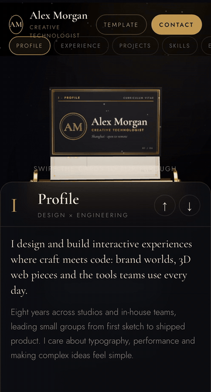
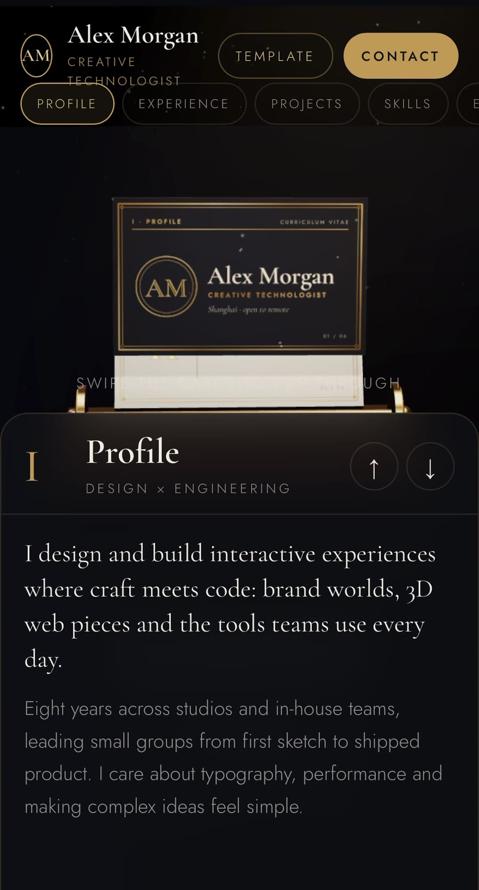
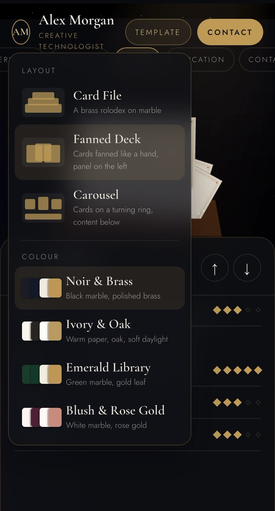
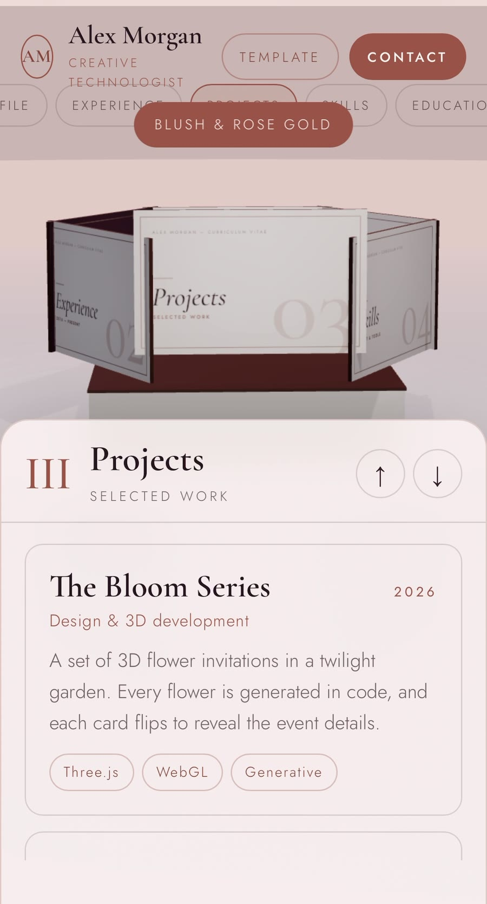

# Cardstack: a 3D card CV

**[▶ Live demo](https://kheleey.github.io/cardstack/)** · Free to use under the [MIT License](LICENSE)

<p align="center"></p>

### 🎬 Video tour

<a href="https://kheleey.github.io/cardstack/tour.mp4"></a>

**[▶ Watch the full video tour](https://kheleey.github.io/cardstack/tour.mp4)**

### Screenshots

<table><tr><td align="center"><br><sub>Profile card</sub></td><td align="center"><br><sub>Layout and colour menu</sub></td><td align="center"><br><sub>Carousel layout, Blush & Rose Gold</sub></td></tr></table>

A formal, interactive CV presented as a stack of 3D cards. Flip through the cards for profile, experience, skills, projects, education and contact.

- **Layouts:** File, Deck and Carousel. Each arranges the cards differently.
- **Colour themes:** Noir, Ivory, Emerald and Blush.
- Your choices are remembered between visits.

## ✦ AI summary

A short AI-written summary of the CV sits beside it, or behind the ✦ button on smaller screens. Out of the box it shows a sample (`aiSample`). To have an AI write it live from your CV, add a key to the `ai` settings in the `window.CV` block:

```js
// Anthropic
ai: { provider: 'anthropic', apiKey: 'sk-ant-…', model: 'claude-haiku-5-5', baseURL: '' },

// or any OpenAI-compatible service (OpenAI, DeepSeek, …)
ai: { provider: 'openai', apiKey: 'sk-…', model: 'your-model-name', baseURL: 'https://api.openai.com/v1' },
```

**Keep your key private.** A key written into this file can be seen by anyone who opens the page. Never commit a real key to a public repository. Only add one in your own local copy, or use a key with a strict spending limit.

## Make it yours

Edit the `window.CV` block near the top of `index.html`: name, role, contact, experience, projects, skills and education.

## Built with

A single HTML file of plain HTML, CSS and JavaScript, with fonts from Google Fonts.

## Use it for your own

1. Click **Fork** at the top of this page, or **Code → Download ZIP**.
2. Open `index.html` in any text editor and change the content block near the top.
3. Publish it with GitHub Pages (below), or open `index.html` in a browser.

Free to use, change and share, including commercially. Please keep the `LICENSE` file.

## Publish it as a website (GitHub Pages)

1. Upload this folder's files to a new **public** GitHub repository.
2. Go to **Settings → Pages**, choose **Deploy from a branch**, pick `main` and `/ (root)`, then click **Save**.
3. After a minute or two it's live at `https://<your-username>.github.io/<repo-name>/`.

You can also just open `index.html` in a browser.

## License

MIT. See [LICENSE](LICENSE).
